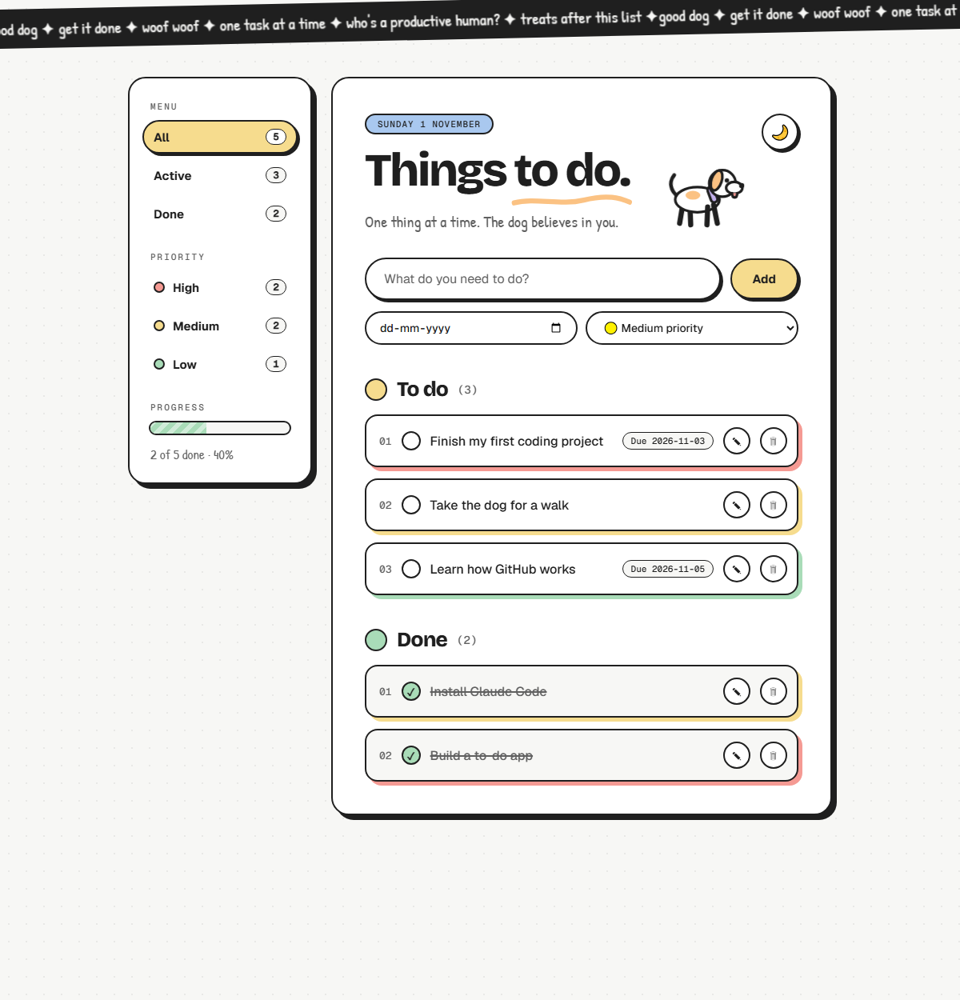

# 🐶 Things to do.

**My first ever coding project: a to-do list app, built from zero knowledge with the help of [Claude Code](https://claude.com/claude-code).**

Before this project I had never written a line of code. I didn't know what HTML was, what a function was, or how GitHub worked. This README is the log of how I got from nothing to a working, good-looking app, mistakes included.

---

## ✨ What it does

- ➕ **Add, edit and delete tasks**
- ✅ **Tick tasks off.** Finished tasks move into their own **Done** section.
- 📅 **Due dates.** Overdue tasks turn pink.
- 🔴🟡🟢 **Priorities** (High / Medium / Low), shown as the color of each task card's shadow
- 🗂️ **Sidebar menu** to filter by All / Active / Done or by priority, with live counts
- 📊 **Progress bar** that fills up as you finish tasks
- 💾 **Remembers everything**, even after you close the browser
- 🌙 **Dark mode**, which is also remembered
- 🐕 **A dog mascot** that wags its tail and blinks. Click it and it talks to you. Finish a task and a dog runs across the screen. Click anywhere and paw prints appear 🐾
- 📱 **Works on phones too**

## 🚀 How to use it

No installing needed. It's just three files.

1. Click the green **Code** button on this page, then **Download ZIP**.
2. Unzip it.
3. Double-click **`index.html`**. It opens in your web browser and you're ready to go.

Your tasks are saved in your own browser only. Nothing is sent anywhere.

## 📁 What's inside

| File | What it does | Think of it as… |
|---|---|---|
| `index.html` | **What** is on the page: title, text box, buttons, lists | The walls and rooms of a house |
| `style.css` | **How it looks**: colors, fonts, shadows, animations | The paint and decoration |
| `script.js` | **What it does**: adding, saving, filtering, the dog | The electricity and plumbing |

Plain HTML, CSS and JavaScript, with no frameworks and no libraries. The code has lots of comments, because I needed them to understand it.

---

## 🛣️ The journey log

I worked with Claude Code (an AI coding assistant that runs in your terminal or code editor). I asked it to be very guided and explain everything simply. For most steps it showed me the code and explained it, and **I typed it in myself**. For the big redesigns, it built the changes and then walked me through them.

### Step 0: The starting point
Zero knowledge. Claude asked me a few questions first: what my goal was (learn *and* get a working app), where the app should run (a web browser, because that's easiest for beginners), and which features I wanted to start with (just add and delete).

### Step 1: The first version: add & delete
Claude built a tiny app and explained the **three files every web page is made of** (HTML, CSS and JavaScript). My first change ever was turning the background pink by editing one line of CSS. 🎀

> **Learned:** tags (`<h1>`, `<button>`), ids, CSS colors, and the cycle of *change → save → refresh → see the result*.

### Step 2: Mark tasks as done
I added a checkbox to each task. Ticking it crosses the task out.

> **Learned:** `addEventListener` ("when this is clicked, do that") and `classList.toggle` (switching a style on and off, like a light switch).

### Step 3: Remember tasks 💾
Tasks used to vanish when I refreshed the page. Now they're saved in the browser.

> **Learned:** `localStorage` (the browser's little notebook), `JSON` (turning lists into text and back), splitting one function into two, arrays `[]` and objects `{}`.

**😅 My first big mistake:** I pasted three new functions *inside* another function instead of after it. The braces `{ }` stopped matching, the browser couldn't read the file, and **nothing worked at all**.
**Lesson:** a function is a box from `{` to `}`. Functions shouldn't be put inside other boxes by accident. Also: press **F12 → Console** to see red error messages.

### Step 4: Edit a task ✏️
I added an Edit button that pops up a box to change the text.

> **Learned:** `prompt()`, plus `!==` ("is not equal to") and `&&` ("and").

### Step 5: Filters: All / Active / Done 🔍
> **Learned:** `let` vs `const`, `if / else if / else`, `!` ("not"), and `data-` attributes for attaching little notes to HTML.

### Step 6: Due dates & priorities 📅
Each task got a date picker and a High / Medium / Low priority. Overdue dates turn red.

> **Learned:** joining text with `+`, default values with `||`, and comparing dates.

### Step 7: Editing dates too
I wanted to add a date to tasks that didn't have one, so Edit became an in-place edit with a text box and a date picker.

> **Learned:** **don't repeat yourself**. The date code was needed in two places, so it moved into its own reusable function.

**😅 Mistake #2:** I deleted code from the *wrong* function, because two places had almost identical code. That left an `else` with no `if`.
**Lesson:** before deleting or pasting, check which function you're in. Look for the nearest `function ...` line above.

### Step 8: Dark mode 🌙 and a task counter
> **Learned:** one class on `<body>` can change the whole page's look. Also `.length` for counting.

**😅 Mistake #3:** I pasted code into a place that *calls* a function, instead of the function *itself*.
**Lesson:** `saveTasks();` **runs** a function and can appear in many places. `function saveTasks() {` is where it's **defined**, and it exists in only one place.

### Step 9: Making it look good: four redesigns 🎨
This is where it got fun. I tried a few looks until one felt right:
1. **Minimal & clean:** white and grey, round checkboxes, icon buttons (✎ 🗑)
2. **Editorial:** warm paper colors, big thin headlines and serif fonts
3. **Neo-brutalism:** thick black outlines, hard sticker-like shadows, and buttons that "press in" when clicked
4. **Final: neo-brutalism with soft pastels and a dog theme**, using handwritten fonts, a scrolling banner and a scribbled underline that draws itself

> **Learned:** CSS **variables** (name every color once at the top, so dark mode only has to swap a few names), Google Fonts, `transition` and `@keyframes` animations, `:hover` / `:active` / `:focus-within`, and `@media` for phone screens.

### Step 10: Sidebar menu + a separate Done section 🗂️
Finished tasks now move to their own section. The filters moved into a sidebar with live counts and a progress bar.

> **Learned:** `appendChild` *moves* an element if it's already on the page, the difference between `class` (reusable) and `id` (unique), CSS grid layouts, and `:empty`.

### Step 11: The dog 🐶
I added a mascot drawn from simple SVG shapes (circles, ellipses and lines). Its tail wags from its base, its eye blinks, and it hops and talks when clicked. When you finish a task, a copy of it runs across the screen. Paw prints follow your clicks.

> **Learned:** SVG drawing, `transform-origin` (what something rotates around), `cloneNode`, `setTimeout`, `Math.random()`, and mouse positions (`clientX` / `clientY`).

### Step 12: Putting it on GitHub 🐙
The last step was learning what Git and GitHub are, and publishing this project so anyone can see it, including this README!

---

## 🧠 The biggest things I learned

1. **Code is very literal.** One missing `}` or `,` can break everything, and that's normal.
2. **Read the error.** **F12 → Console** tells you what's wrong, and usually where.
3. **Small steps.** Change one thing, save, refresh, test. Repeat.
4. **Typing the code yourself** (instead of only copy-pasting) is how it actually sticks.
5. **Mistakes are the lesson.** My three biggest bugs taught me more than the features did.

## 💡 Tips if you're a beginner too

- Ask the AI to **explain every line** and to **let you type** the code.
- When something breaks, say *"check my code"* and ask **why** it broke, not just for the fix.
- In VS Code, click next to a `{` and its matching `}` lights up.
- You don't need to understand everything at once. I still don't!

## 🛠️ Built with

- HTML, CSS and JavaScript (no frameworks)
- [Claude Code](https://claude.com/claude-code) as my coding teacher and pair programmer
- Fonts from [Google Fonts](https://fonts.google.com/): Bricolage Grotesque, Geist, Geist Mono and Patrick Hand

---

*Started 31 October 2026 · Published 1 November 2026 · Made with patience, a lot of questions, and one very good dog.* 🐾
